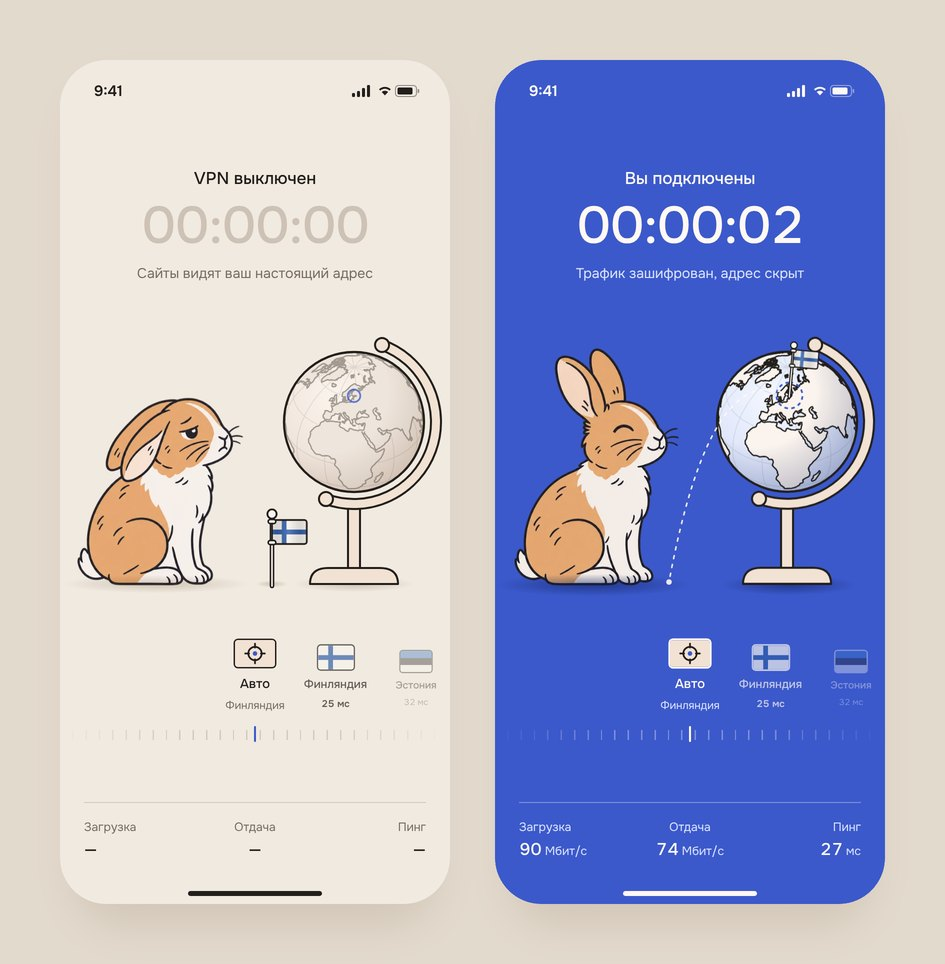

# VPN с Крохой

Главный экран мобильного VPN без большой кнопки включения. Тестовое задание на продуктового дизайнера

**Прототип** https://kirter17.github.io/kroha-vpn/
**Как менялся экран** https://kirter17.github.io/kroha-vpn/process.html

## Кроха

Это Кроха, моя крольчиха. Кролика в прототипе рисовали с её фото, поэтому он такой же рыжий, с белой полоской на носу и белой грудкой. Пока VPN выключен, Кроха грустит и опускает уши. Когда включён, подпрыгивает и поднимает их

## Как пользоваться

- Тап по кролику, глобусу или флажку включает VPN, повторный тап выключает
- Снизу лента из 26 стран. Тап по стране подключает к ней, повторный тап по ней же выключает
- Авто проверяет пинг до всех стран, глобус в это время крутится. Флажок ждёт над глобусом и садится на самую быструю страну, когда глобус остановится. Ещё один тап по Авто запускает новый поиск

## Как сделано

Прототип собран в одном HTML файле, шрифт и картинки встроены внутрь. Глобус рисуется на d3-geo по контурам Natural Earth. Синяя заливка экрана и полёт флажка построены на transform, поэтому анимации не лагают на телефоне

Иллюстрации кролика сгенерировал в ChatGPT по фото Крохи. Экран, анимации и логику собирал в Claude: описывал задачу словами, проверял скриншоты каждой версии и правил. Claude Design в моём аккаунте так и не появился, поэтому работал в обычном Claude

Страница [process.html](process.html) показывает все 9 версий экрана с заметками, что менялось и почему

## Открыть у себя

Скачайте репозиторий и откройте `index.html` в браузере
